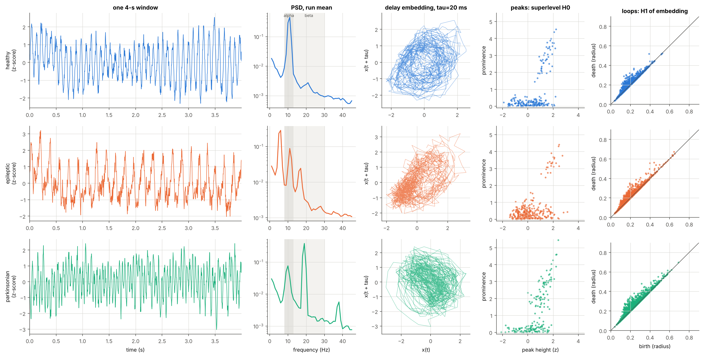
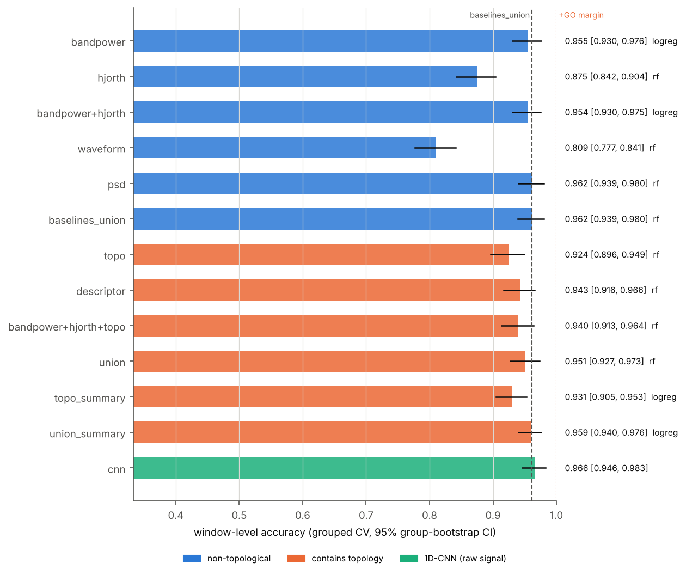
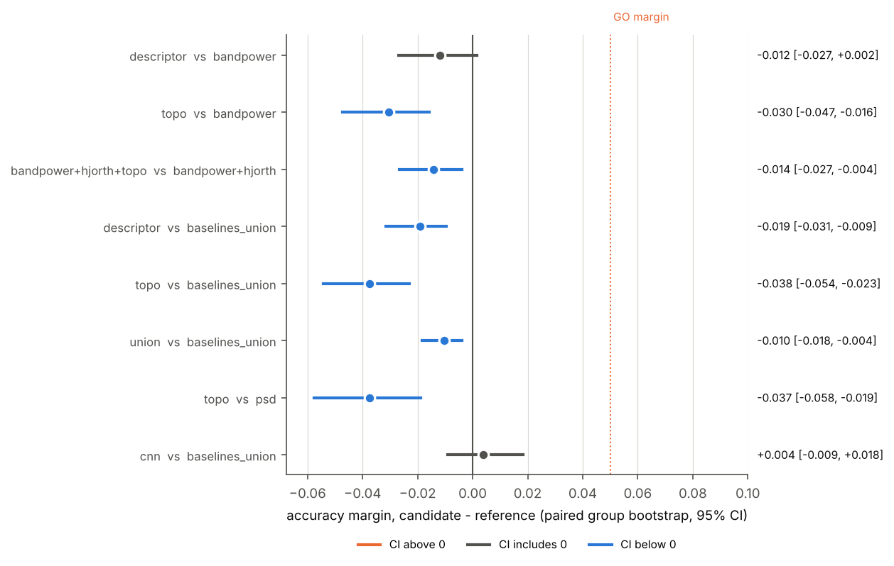
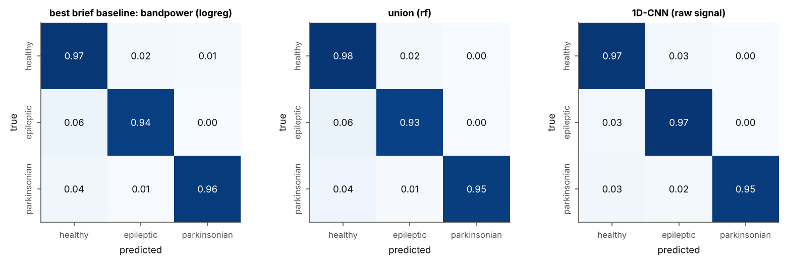
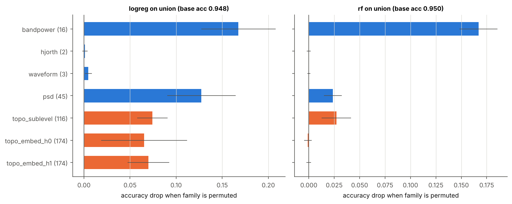
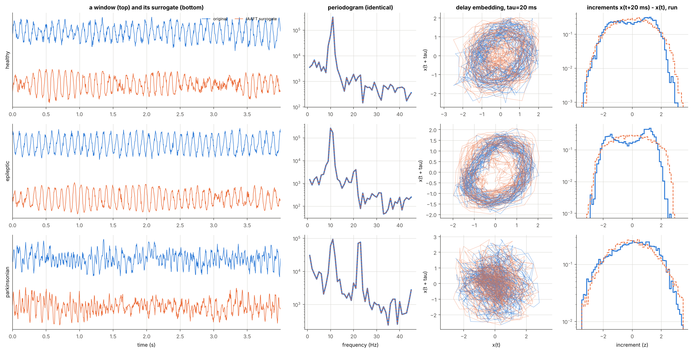
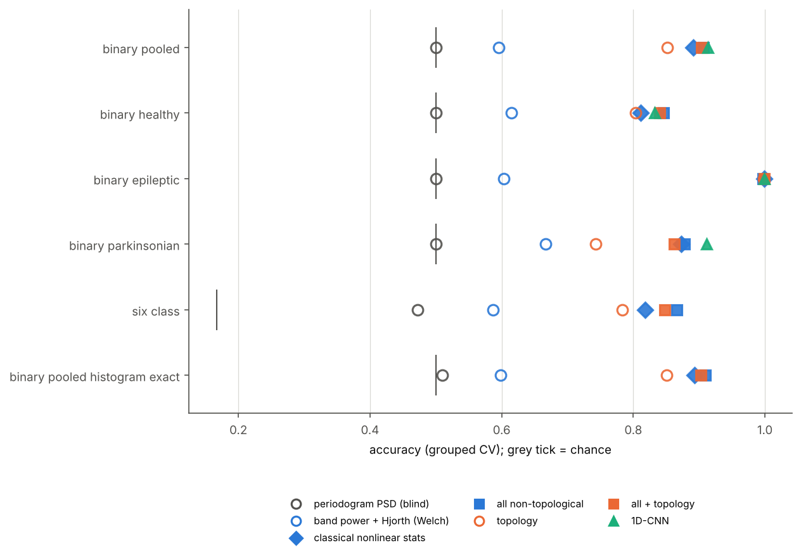

# neuro-rhythms-tda

Classifying **healthy vs epileptic vs parkinsonian** brain rhythms simulated
with neural mass models, using a **topological-spectral descriptor**
(persistent homology + power spectrum, computed with GUDHI), strong
non-topological baselines and a small **1D-CNN**, all under cross-validation
grouped by simulation run. The goal is an honest Go/No-Go verdict on whether
topology adds value over band-power baselines.

Everything is synthetic and runs offline: no external data, no API keys.

## Result (full run): NO-GO

**Topology does not add value over band-power baselines on this task.**
Setup: 240 simulation runs, 2400 four-second windows, StratifiedGroupKFold
(4 folds x 5 repeats) grouped by run, and paired group-bootstrap 95 % CIs.
The GO rule is the GEM rule: margin >= +0.05 accuracy.

| question | candidate | reference | margin [95% CI] | verdict |
|---|---|---|---|---|
| as briefed | topological-spectral descriptor, 0.943 | band power, 0.955 | -0.012 [-0.027, +0.002] | **NO-GO** |
| strict | best topology-containing set, 0.959 | all non-topological features, 0.962 | -0.002 [-0.012, +0.008] | **NO-GO** (headroom 0.038 < 0.05) |
| incremental | all features incl. topology, 0.951 | all non-topological features, 0.962 | -0.010 [-0.018, -0.004] | **NO-GO** (topology hurts slightly) |
| deep model | 1D-CNN on raw signal, 0.966 | all non-topological features, 0.962 | +0.004 [-0.009, +0.018] | tie |

- **Topology carries the information, but less of it than the spectrum.** The
  topological view alone reaches 0.924 (chance 0.333). That is 0.037 below
  the plain log-PSD.
- **It is the least noise-robust view.** In an exploratory noise sweep it
  falls to 0.740 at 4x measurement noise; the baseline union holds 0.903.
- **The leak detectors pass.** Permuted labels give 0.340. Ignoring the run
  grouping would have inflated accuracy by up to 2 points.
- **What is left is borderline cases.** About 10 % of epileptic and 14 % of
  parkinsonian runs sit near their bifurcation boundaries and look partly
  healthy. That is where the errors are.

Full tables: [`docs/RESULTS.md`](docs/RESULTS.md). Interpretation for
neuroscientists: [`docs/SCIENCE.md`](docs/SCIENCE.md) section 6.



| accuracy of every view | margins vs baselines |
|---|---|
|  |  |
|  |  |

## Follow-up: IAAFT surrogate benchmark, also NO-GO

**Question.** Does topology at least see the nonlinear temporal structure
that the spectrum cannot? (The main classes are spectrally defined, which
favours spectral baselines.) Every 4 s window is paired with an IAAFT
surrogate that has the same periodogram and amplitude histogram but random
phases. The task is original vs surrogate, so spectral and one-point
features are blind by construction: they score 0.500-0.517. The strict
competitor is the set of classical nonlinear statistics (time-reversal
asymmetry, third-order autocorrelation, waveform sharpness). Same runs,
grouped CV and GEM rule as above.

| primary task: original vs surrogate | candidate | reference | margin [95% CI] | verdict |
|---|---|---|---|---|
| as briefed | descriptor, 0.848 | band power + Hjorth (Welch), 0.595 | +0.253 [+0.232, +0.276] | GO, but uninformative: the reference is nearly blind |
| strict | best topology-containing set, 0.906 | all non-topological features, 0.907 | -0.001 [-0.009, +0.007] | **NO-GO** (headroom 0.093) |
| head-to-head | topology alone, 0.852 | classical nonlinear statistics, 0.891 | -0.039 [-0.054, -0.025] | classical better |
| deep model | 1D-CNN, 0.913 | all non-topological features, 0.907 | +0.006 [-0.002, +0.015] | tie |

- **Topology does detect nonlinear structure** (0.85 with identical
  spectra), but it detects less of it than 25 classical statistics.
- **It adds nothing to them** on any task: pooled, per rhythm, six-class,
  and histogram-exact surrogates.
- **It is weakest on parkinsonian beta**, where the CNN is the only method
  with a CI above the baselines (+0.034 [+0.018, +0.049]).

Report: [`docs/RESULTS_SURROGATE.md`](docs/RESULTS_SURROGATE.md);
interpretation in [`docs/SCIENCE.md`](docs/SCIENCE.md) section 8.





## How it works

```
 per class, per run:  draw parameters  ->  coupled Jansen-Rit column + STN-GPe loop  ->  "EEG"
                                            (Euler-Maruyama, dt = 0.5 ms, 250 Hz)
 measurement:         z-score + 1/f noise + white noise -> 0.5 Hz high-pass -> 4 s windows -> z-score
 features:            bandpower | hjorth | waveform | psd | topo (GUDHI)  -> feature sets and unions
 models:              LogReg, RandomForest (best of two per set) | 1D-CNN on raw windows
 evaluation:          repeated StratifiedGroupKFold (group = run), paired group-bootstrap CIs,
                      GO iff margin >= +0.05 accuracy (GEM rule)
```

| class | signature | how it is produced |
|---|---|---|
| healthy | ~10 Hz alpha | Jansen-Rit standard regime; basal-ganglia loop below its Hopf threshold |
| epileptic | 2-6 Hz spike-and-slow-wave | raised excitatory gain `A`, lower input (Wendling et al. 2000/2002) |
| parkinsonian | alpha + 14-30 Hz beta | STN-GPe loop gain above the analytic Hopf threshold (Holgado et al. 2010), routed to the column |

Details, equations, parameter ranges and references: [`docs/SCIENCE.md`](docs/SCIENCE.md).

## Repository layout

```
src/neurorhythms/
  neural_mass.py      Jansen-Rit + STN-GPe model, vectorised over runs
  regimes.py          class parameter regimes, analytic Hopf threshold of the STN-GPe loop
  dataset.py          simulation runs -> measurement model -> windows (+ run ids)
  signatures.py       descriptive check that each class shows its signature
  features/
    baseline.py       band powers, ratios, SEF, Hjorth, waveform stats, log-PSD
    topology.py       GUDHI sublevel-set + delay-embedding (Alpha) persistence, vectorisations
    __init__.py       feature sets: baselines, topo, descriptor, unions
  classical.py        grouped folds, LogReg / RandomForest cross-validation
  deep.py             1D-CNN (PyTorch) on the same folds
  stats.py            accuracy, group bootstrap, paired margins, Go/No-Go rule
  importance.py       feature-family permutation importance
  plots.py, report.py figures and the generated Markdown report
  pipeline.py         end-to-end CLI (python -m neurorhythms)
  surrogates.py       IAAFT surrogates (spectrum-exact / histogram-exact)
  features/nonlinear.py  one-point and classical nonlinear statistics
  surrogate_benchmark.py, surrogate_report.py   the IAAFT follow-up benchmark
configs/small.yaml    default, ~1.5 min (CI)
configs/full.yaml     reported run, ~1 h on 4 cores
configs/surrogate_small.yaml, configs/surrogate_full.yaml   IAAFT follow-up (~1.5 min / ~20 min)
docs/RESULTS.md       generated by the full run (do not edit by hand)
docs/RESULTS_SURROGATE.md   generated by the full surrogate run
docs/SCIENCE.md       background for neuroscientists, with references
figures/              figures of the full run (figures/surrogate/: surrogate benchmark)
results/full/, results/surrogate_full/   results.json of the full runs
tests/                pytest suite (offline)
```

## Reproduce

```bash
pip install torch --index-url https://download.pytorch.org/whl/cpu   # for the CNN (optional)
pip install -e ".[dev]"
pytest -q                                          # 41 tests, offline, ~2 min
python -m neurorhythms                             # small default config -> results/small/
python -m neurorhythms --config configs/full.yaml  # full run -> results/full/, figures/, docs/RESULTS.md
python -m neurorhythms --config configs/full.yaml --replot   # re-render figures + report only
python -m neurorhythms.surrogate_benchmark                   # IAAFT follow-up, small config
python -m neurorhythms.surrogate_benchmark --config configs/surrogate_full.yaml   # ~20 min
```

Without PyTorch, pass `--no-cnn`. Simulations and features are cached in
`data/cache/` (keyed by a hash of the configuration); `--no-cache` disables it.
All randomness is seeded.

## License

MIT, Copyright (c) 2026 Cesar Daniel Reinoso. See [`LICENSE`](LICENSE).
