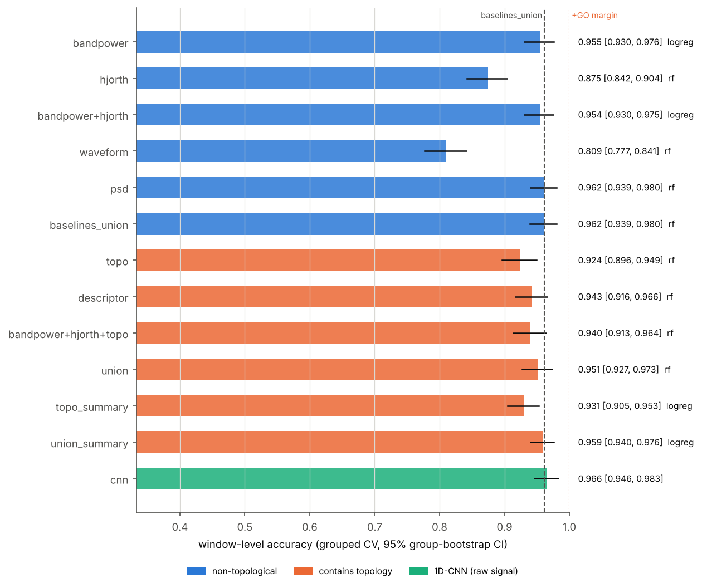
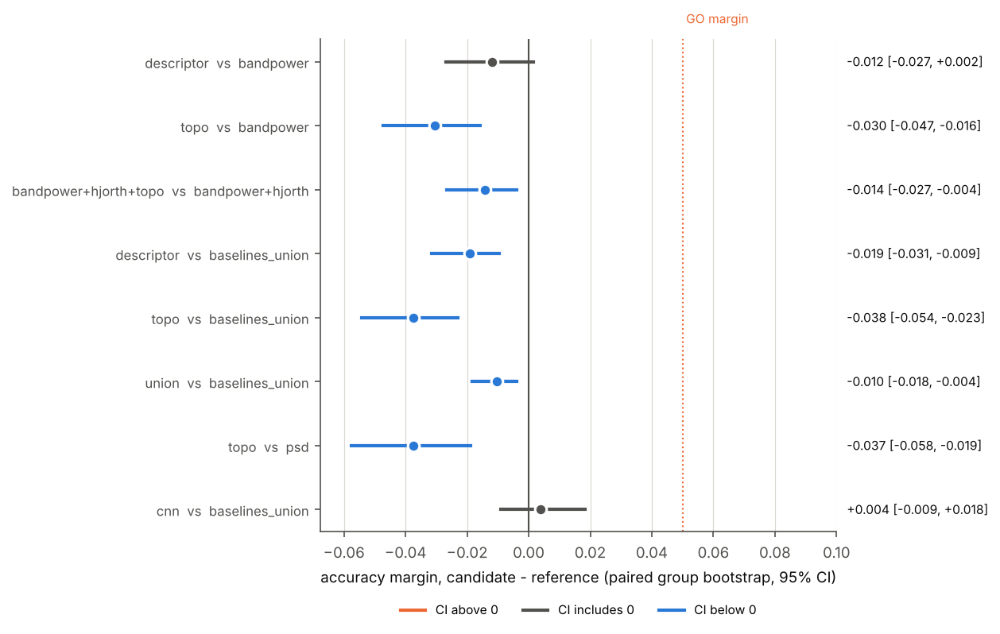
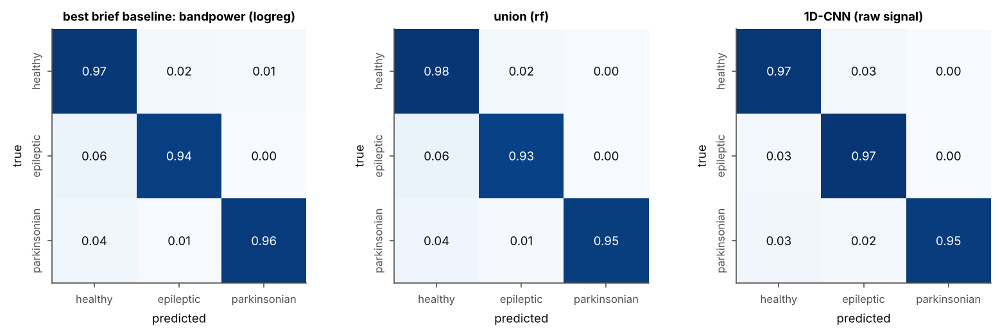
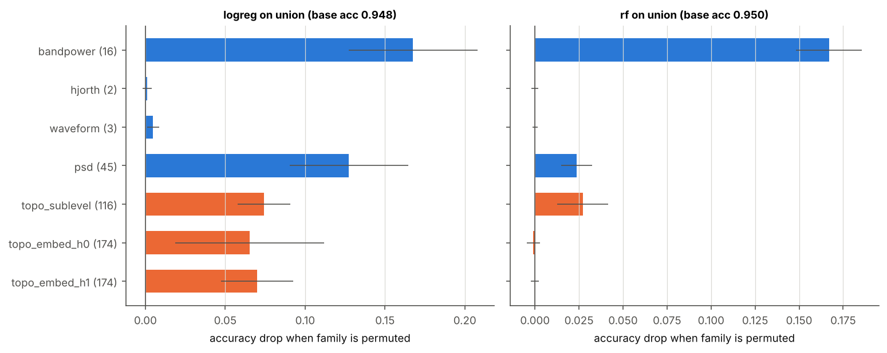
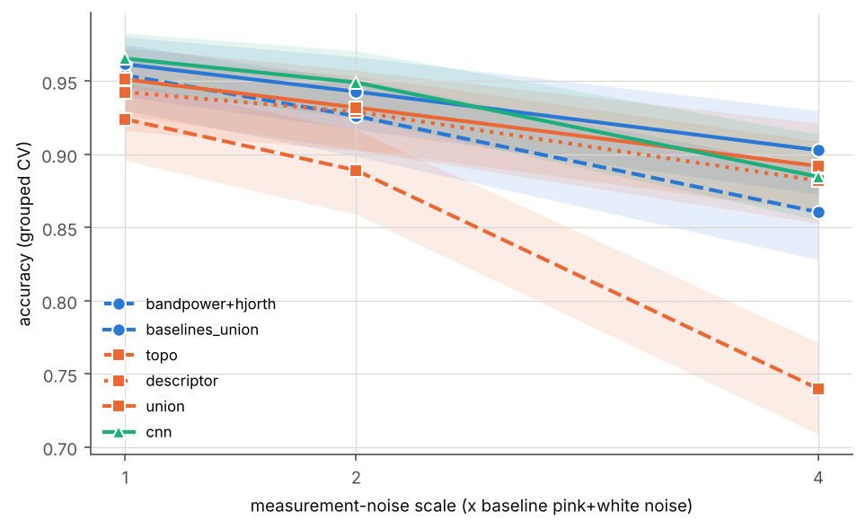
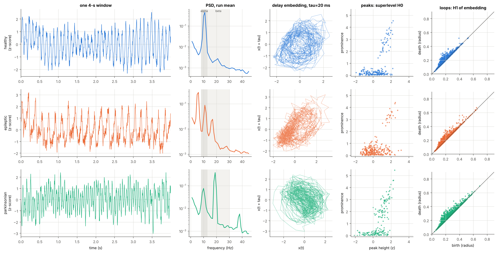

# Results — neural-mass rhythm benchmark (config `full`)

_Generated automatically by `python -m neurorhythms --config ...` on 2026-11-02; runtime 38.6 min. Every number below is read from `results.json`; do not edit by hand._

## Verdict

**Final (strict) verdict: NO-GO.** Rule, as in the GEM benchmark: GO iff a configuration that contains the topological view beats the reference by >= +0.05 accuracy (paired group-bootstrap 95 % CI reported alongside).

| Question | candidate | reference | candidate acc | reference acc | margin [95% CI] | rule (>= +0.05) |
|---|---|---|---|---|---|---|
| As briefed: topological-spectral descriptor vs band-power / Hjorth baselines | descriptor | bandpower | 0.943 | 0.955 | -0.012 [-0.027, +0.002] | **NO-GO** |
| Strict: best topology-containing set vs all non-topological baselines | union_summary | baselines_union | 0.959 | 0.962 | -0.002 [-0.012, +0.008] | **NO-GO** |
| Incremental: baselines_union + topology vs baselines_union | union | baselines_union | 0.951 | 0.962 | -0.010 [-0.018, -0.004] | NO-GO |

- As briefed, the descriptor does not reach the +0.05 GO margin; the 95 % CI includes 0 (no detectable difference).
- Strict: `baselines_union` scores 0.962, so the headroom (largest margin any feature set could reach) is 0.038 < 0.05: a GO is arithmetically impossible on this task.
- Adding topology to every baseline changes accuracy by -0.010 [-0.018, -0.004]: it does not reach the +0.05 GO margin; the 95 % CI lies below 0 (the candidate is worse).
- The 1D-CNN on the raw signal reaches 0.966 (+0.004 [-0.009, +0.018] vs `baselines_union`).

## What was run

- **Data.** 240 independent simulation runs (80 per class) of the coupled Jansen-Rit cortical column + STN-GPe loop, 40 s each after a 2 s transient, Euler-Maruyama at dt = 0.5 ms, sampled at 250 Hz. Measurement model: z-scored model output + 1/f noise (level U(0.2, 0.8)) + white noise (U(0.05, 0.2)), 0.5 Hz high-pass, 4 s non-overlapping windows, each z-scored. 2400 windows (10 per run, classes [800, 800, 800]). Predicted beta frequency at onset in the parkinsonian runs: 17.0-27.3 Hz.
- **Protocol.** Repeated StratifiedGroupKFold (4 folds x 5 repeats), group = simulation run, identical folds for every feature set and the CNN. LogReg (standardised, C = 1) and RandomForest (300 trees); the better of the two is reported per feature set (as in GEM). Paired group-bootstrap CIs (2000 resamples of runs). Primary metric: window-level accuracy (classes are balanced, so it equals balanced accuracy).
- **Deep model.** 1D-CNN, 47,427 parameters, 25 epochs (fixed, no early stopping), AdamW lr 0.001, batch 64, on the raw z-scored window (1000 samples).

## Do the classes show their intended signatures?

Computed on the noise-free model output of every run (no classifier involved): median [10th-90th percentile] over runs.

| class | slow (1-7.5 Hz) | alpha (7.5-13 Hz) | beta (13-30 Hz) | peak frequency (Hz) | skewness | signature holds | criterion |
|---|---|---|---|---|---|---|---|
| healthy | 0.00 [0.00, 0.02] | 0.97 [0.89, 0.99] | 0.02 [0.01, 0.09] | 11.00 [10.50, 11.00] | 0.05 [0.01, 0.11] | 99 % of 80 runs | alpha is the dominant band (largest relative power of slow/alpha/beta) |
| epileptic | 0.73 [0.52, 0.78] | 0.18 [0.14, 0.33] | 0.08 [0.05, 0.10] | 5.00 [4.00, 7.05] | 0.98 [0.66, 1.13] | 90 % of 80 runs | slow band dominant AND skewness > 0.5 (tall positive spikes) |
| parkinsonian | 0.01 [0.00, 0.01] | 0.61 [0.15, 0.90] | 0.38 [0.09, 0.84] | 11.00 [10.00, 20.50] | -0.06 [-0.48, 0.13] | 86 % of 80 runs | beta relative power >= 0.10 (healthy median is ~0.03) |

## Accuracy of every view

| group | feature set | # features | LogReg | RF | best [95% CI] | macro-F1 | run-level acc |
|---|---|---|---|---|---|---|---|
| Brief-named baselines | **bandpower** | 16 | 0.955 | 0.947 | 0.955 [0.930, 0.976] (logreg) | 0.955 | 0.963 |
| Brief-named baselines | **hjorth** | 2 | 0.861 | 0.875 | 0.875 [0.842, 0.904] (rf) | 0.876 | 0.915 |
| Brief-named baselines | **bandpower+hjorth** | 18 | 0.954 | 0.947 | 0.954 [0.930, 0.975] (logreg) | 0.954 | 0.963 |
| Strict non-topological baselines | **waveform** | 3 | 0.806 | 0.809 | 0.809 [0.777, 0.841] (rf) | 0.811 | 0.849 |
| Strict non-topological baselines | **psd** | 45 | 0.927 | 0.962 | 0.962 [0.939, 0.980] (rf) | 0.962 | 0.962 |
| Strict non-topological baselines | **baselines_union** | 66 | 0.955 | 0.962 | 0.962 [0.939, 0.980] (rf) | 0.962 | 0.962 |
| Topological / topological-spectral | **topo** | 464 | 0.908 | 0.924 | 0.924 [0.896, 0.949] (rf) | 0.925 | 0.938 |
| Topological / topological-spectral | **descriptor** | 509 | 0.939 | 0.943 | 0.943 [0.916, 0.966] (rf) | 0.943 | 0.951 |
| Topological / topological-spectral | **topo_summary** | 80 | 0.931 | 0.919 | 0.931 [0.905, 0.953] (logreg) | 0.931 | 0.954 |
| Incremental (topology added to baselines) | **bandpower+hjorth+topo** | 482 | 0.933 | 0.940 | 0.940 [0.913, 0.964] (rf) | 0.941 | 0.948 |
| Incremental (topology added to baselines) | **union** | 530 | 0.949 | 0.951 | 0.951 [0.927, 0.973] (rf) | 0.952 | 0.952 |
| Incremental (topology added to baselines) | **union_summary** | 146 | 0.959 | 0.956 | 0.959 [0.940, 0.976] (logreg) | 0.959 | 0.971 |
| Deep model | **cnn** | raw signal | – | – | 0.966 [0.946, 0.983] | 0.966 | 0.968 |

## Paired comparisons

| candidate | reference | candidate acc | reference acc | margin [95% CI] | P(margin <= 0) | rule |
|---|---|---|---|---|---|---|
| descriptor | bandpower | 0.943 | 0.955 | -0.012 [-0.027, +0.002] | 0.961 | NO-GO |
| topo | bandpower | 0.924 | 0.955 | -0.030 [-0.047, -0.016] | 1.000 | NO-GO |
| bandpower+hjorth+topo | bandpower+hjorth | 0.940 | 0.954 | -0.014 [-0.027, -0.004] | 0.999 | NO-GO |
| descriptor | baselines_union | 0.943 | 0.962 | -0.019 [-0.031, -0.009] | 1.000 | NO-GO |
| topo | baselines_union | 0.924 | 0.962 | -0.038 [-0.054, -0.023] | 1.000 | NO-GO |
| union | baselines_union | 0.951 | 0.962 | -0.010 [-0.018, -0.004] | 1.000 | NO-GO |
| topo | psd | 0.924 | 0.962 | -0.037 [-0.058, -0.019] | 1.000 | NO-GO |
| cnn | baselines_union | 0.966 | 0.962 | +0.004 [-0.009, +0.018] | 0.292 | NO-GO |

Every topology-containing set against `baselines_union` (the strict rule):

| set | accuracy | margin vs baselines_union [95% CI] | rule |
|---|---|---|---|
| topo | 0.924 | -0.038 [-0.054, -0.023] | NO-GO |
| descriptor | 0.943 | -0.019 [-0.031, -0.009] | NO-GO |
| bandpower+hjorth+topo | 0.940 | -0.022 [-0.035, -0.010] | NO-GO |
| union | 0.951 | -0.010 [-0.018, -0.004] | NO-GO |
| topo_summary | 0.931 | -0.031 [-0.045, -0.019] | NO-GO |
| union_summary | 0.959 | -0.002 [-0.012, +0.008] | NO-GO |

## Confusion matrices (row-normalised, pooled over repeats)

best_brief_baseline

| true \ predicted | healthy | epileptic | parkinsonian |
|---|---|---|---|
| healthy | 0.970 | 0.018 | 0.012 |
| epileptic | 0.062 | 0.938 | 0.000 |
| parkinsonian | 0.037 | 0.008 | 0.955 |

union

| true \ predicted | healthy | epileptic | parkinsonian |
|---|---|---|---|
| healthy | 0.976 | 0.021 | 0.004 |
| epileptic | 0.064 | 0.932 | 0.005 |
| parkinsonian | 0.042 | 0.011 | 0.946 |

cnn

| true \ predicted | healthy | epileptic | parkinsonian |
|---|---|---|---|
| healthy | 0.971 | 0.028 | 0.002 |
| epileptic | 0.026 | 0.973 | 0.001 |
| parkinsonian | 0.032 | 0.016 | 0.953 |

## Which feature families carry the signal?

Grouped permutation importance on the `union` set (all columns of a family permuted together on held-out folds of repeat 1; mean accuracy drop).

| family | # features | logreg drop | rf drop |
|---|---|---|---|
| bandpower | 16 | +0.168 | +0.167 |
| hjorth | 2 | +0.001 | -0.000 |
| waveform | 3 | +0.005 | +0.000 |
| psd | 45 | +0.127 | +0.024 |
| topo_sublevel | 116 | +0.074 | +0.027 |
| topo_embed_h0 | 174 | +0.065 | -0.001 |
| topo_embed_h1 | 174 | +0.070 | -0.000 |

Permutation importance measures how much a *fitted* model relies on a family, not how much unique information the family carries: a linear model that spreads weight over redundant families loses accuracy when any one of them is scrambled, while a random forest can route around it. Compare the two columns with that in mind.

## Sanity checks (leak detectors)

| check | value | expectation |
|---|---|---|
| union / LogReg with run labels permuted | 0.340 | chance (0.333) |
| topo / RF, grouped CV (repeat 1) vs ungrouped CV | 0.925 vs 0.937 | ungrouped >= grouped (window leakage inflates) |
| baselines_union / RF, grouped CV (repeat 1) vs ungrouped CV | 0.964 vs 0.984 | ungrouped >= grouped (window leakage inflates) |

## Exploratory: robustness to measurement noise (post hoc, not part of the verdict)

The same simulated runs, with the pink + white measurement noise multiplied by the scale factor (2 CV repeat(s) for scales > 1).

| noise scale | bandpower+hjorth | baselines_union | topo | descriptor | union | cnn |
|---|---|---|---|---|---|---|
| x1 | 0.954 | 0.962 | 0.924 | 0.943 | 0.951 | 0.966 |
| x2 | 0.926 | 0.943 | 0.889 | 0.929 | 0.932 | 0.949 |
| x4 | 0.861 | 0.903 | 0.740 | 0.882 | 0.892 | 0.885 |

Margin vs `baselines_union` [95% CI]:

| noise scale | bandpower+hjorth | topo | descriptor | union |
|---|---|---|---|---|
| x1 | -0.008 [-0.017, -0.000] | -0.038 [-0.054, -0.023] | -0.019 [-0.031, -0.009] | -0.010 [-0.018, -0.004] |
| x2 | -0.017 [-0.028, -0.004] | -0.054 [-0.074, -0.034] | -0.014 [-0.029, +0.000] | -0.011 [-0.021, -0.002] |
| x4 | -0.042 [-0.059, -0.026] | -0.163 [-0.191, -0.134] | -0.021 [-0.031, -0.009] | -0.011 [-0.020, -0.001] |

## Example signals

## Caveats

- Synthetic data: the classes are defined by model parameter regimes, so this benchmark measures how well each representation recovers *dynamical regimes of neural-mass models*, not clinical diagnostic accuracy. See `docs/SCIENCE.md`.
- Choosing the better of LogReg / RF per feature set on the same folds is mildly optimistic; it is applied identically to every feature set (GEM convention).
- Windows are the classification unit; runs are the resampling unit of the CIs. Run-level accuracy (mean window probability per run) is reported as a secondary metric.
- The noise sweep (if present) is exploratory and was not part of the pre-specified rule.
