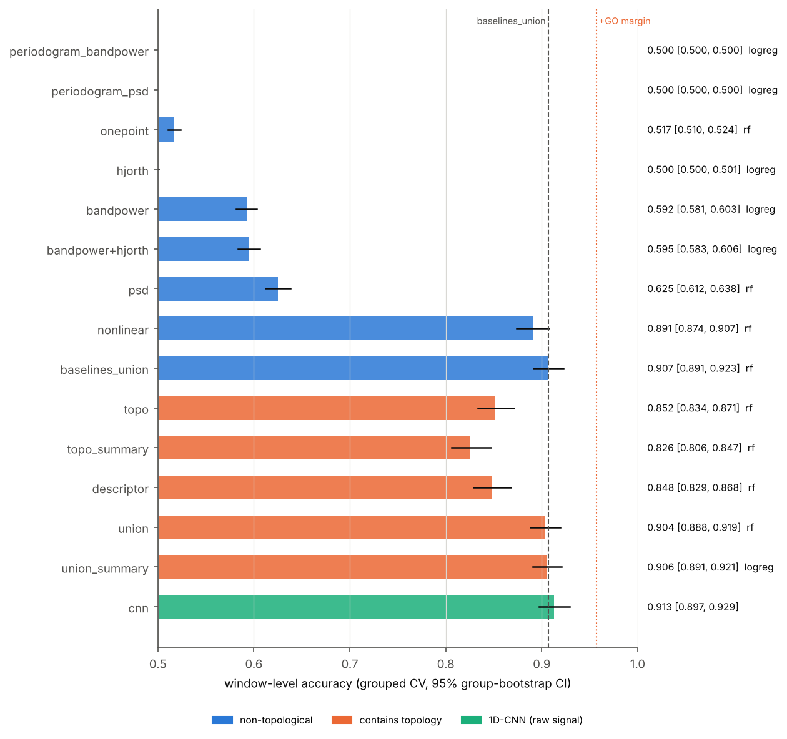
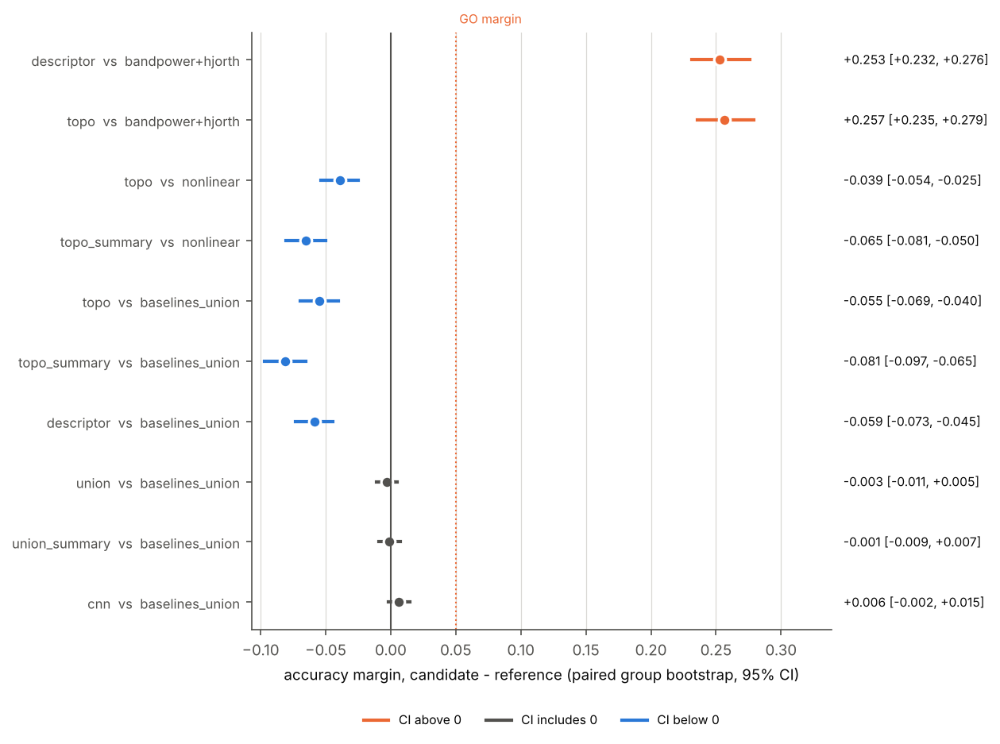
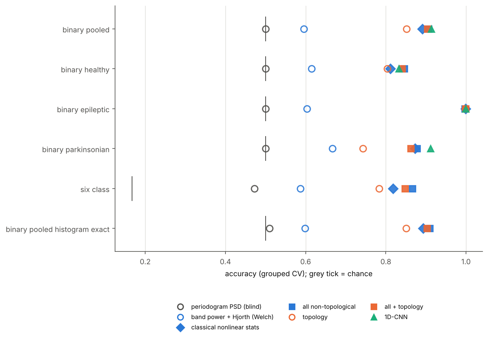
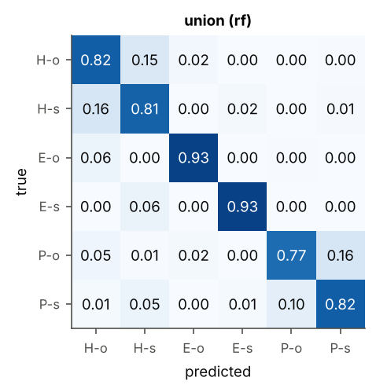
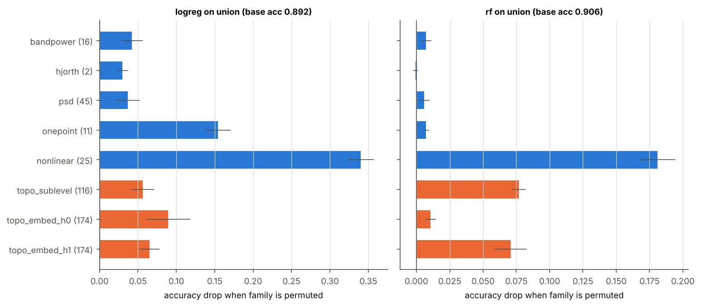
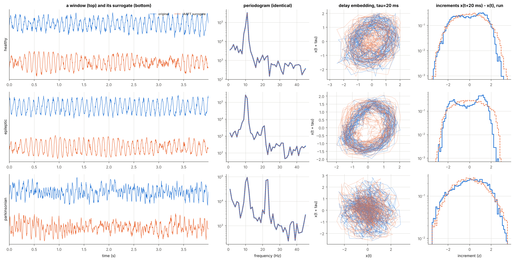

# Results — IAAFT surrogate benchmark (config `surrogate_full`)

_Generated automatically by `python -m neurorhythms.surrogate_benchmark` on 2026-11-03; runtime 19.9 min. Every number below is read from `results.json`; do not edit by hand._

**Question.** Each 4 s window is paired with an IAAFT surrogate that has the same periodogram and the same amplitude histogram but random Fourier phases. Telling them apart requires *nonlinear temporal structure*: time-irreversibility, phase coupling, waveform shape. Does the topological view capture that structure better than the classical nonlinear time-series statistics?

## Verdict

**Final (strict) verdict on the primary task (`binary_pooled`): NO-GO.** Rule, as in the GEM benchmark: GO iff a topology-containing feature set beats the union of all non-topological features by >= +0.05 accuracy (paired group-bootstrap 95 % CI alongside).

| question | candidate | reference | candidate acc | reference acc | margin [95% CI] | rule (>= +0.05) |
|---|---|---|---|---|---|---|
| As briefed: descriptor vs band-power / Hjorth (Welch) | descriptor | bandpower+hjorth | 0.848 | 0.595 | +0.253 [+0.232, +0.276] | **GO** |
| Strict: best topology set vs all non-topological | union_summary | baselines_union | 0.906 | 0.907 | -0.001 [-0.009, +0.007] | **NO-GO** |
| Incremental: all features + topology vs all non-topological | union | baselines_union | 0.904 | 0.907 | -0.003 [-0.011, +0.005] | **NO-GO** |
| Head-to-head: topology vs classical nonlinear statistics | topo | nonlinear | 0.852 | 0.891 | -0.039 [-0.054, -0.025] | **NO-GO** |
| Deep: 1D-CNN vs all non-topological | cnn | baselines_union | 0.913 | 0.907 | +0.006 [-0.002, +0.015] | **NO-GO** |

- **Validity.** The best feature set that is blind by construction (`onepoint`) scores 0.517 [0.510, 0.524]; chance is 0.500. That is a small residual leak through the constraint this surrogate variant matches only approximately (the histogram, for the spectrum-exact variant); the histogram-exact robustness task swaps which constraint is exact. Either way the leak is a few points at most, far below every structure-aware score.
- As briefed, the descriptor reaches the +0.05 GO margin; the 95 % CI lies above 0.
- Strict: `baselines_union` scores 0.907; headroom 0.093. The best topology-containing set (union_summary) does not reach the +0.05 GO margin; the 95 % CI includes 0 (no detectable difference).
- Head-to-head, topology alone vs the classical nonlinear statistics alone: -0.039 [-0.054, -0.025].

## What was run

- **Signals.** The same simulation runs and measurement model as the main benchmark (config seed 2026, 240 runs). Each run is cut into 9 non-overlapping 4 s windows whose start is shifted by at most 0.4 s so that the window's ends join smoothly (median end mismatch 0.32 sd), which avoids the end-point artefact of Fourier surrogates. 2160 windows.
- **Surrogates.** One IAAFT surrogate per window (100 iterations). Primary variant (final step = spectrum): periodogram relative error 5.3e-16 (max), histogram error 3.2e-03 sd (median). Robustness variant (final step = rank order): histogram exact, periodogram error 4.2e-03 (median). Correlation surrogate vs original: median r = -0.00.
- **Protocol.** StratifiedGroupKFold (4 folds; repeats per task below), group = simulation run, so a window and its surrogate are always on the same side. LogReg and RandomForest (300 trees), the better of the two per feature set; paired group-bootstrap CIs (2000 resamples of runs).
- **Feature sets.** *Blind by construction*: spectral features from the full-window periodogram, one-point statistics (quantiles, skewness, kurtosis), Hjorth parameters. *Brief-named*: band powers / ratios / SEF with the usual Welch estimator, Hjorth. *Classical nonlinear*: time-reversal asymmetry, increment flatness and third-order autocorrelation at 7 lags, rise fraction, rise/decay and peak/trough sharpness asymmetry, line length. *Topology*: the main benchmark's GUDHI view (sublevel-set + delay-embedding persistence).

## Primary task (`binary_pooled`): accuracy of every view

| group | feature set | # features | LogReg | RF | best [95% CI] | macro-F1 |
|---|---|---|---|---|---|---|
| blind by construction | **periodogram_bandpower** | 16 | 0.500 | 0.500 | 0.500 [0.500, 0.500] (logreg) | 0.333 |
| blind by construction | **periodogram_psd** | 45 | 0.500 | 0.500 | 0.500 [0.500, 0.500] (logreg) | 0.333 |
| blind by construction | **onepoint** | 11 | 0.508 | 0.517 | 0.517 [0.510, 0.524] (rf) | 0.516 |
| blind by construction | **hjorth** | 2 | 0.500 | 0.499 | 0.500 [0.500, 0.501] (logreg) | 0.500 |
| brief-named (Welch) | **bandpower** | 16 | 0.592 | 0.582 | 0.592 [0.581, 0.603] (logreg) | 0.592 |
| brief-named (Welch) | **bandpower+hjorth** | 18 | 0.595 | 0.588 | 0.595 [0.583, 0.606] (logreg) | 0.594 |
| Welch spectrum | **psd** | 45 | 0.577 | 0.625 | 0.625 [0.612, 0.638] (rf) | 0.624 |
| classical nonlinear | **nonlinear** | 25 | 0.846 | 0.891 | 0.891 [0.874, 0.907] (rf) | 0.891 |
| all non-topological | **baselines_union** | 99 | 0.894 | 0.907 | 0.907 [0.891, 0.923] (rf) | 0.907 |
| topological | **topo** | 464 | 0.826 | 0.852 | 0.852 [0.834, 0.871] (rf) | 0.852 |
| topological | **topo_summary** | 80 | 0.808 | 0.826 | 0.826 [0.806, 0.847] (rf) | 0.826 |
| topological-spectral | **descriptor** | 509 | 0.825 | 0.848 | 0.848 [0.829, 0.868] (rf) | 0.848 |
| all + topology | **union** | 563 | 0.892 | 0.904 | 0.904 [0.888, 0.919] (rf) | 0.904 |
| all + topology | **union_summary** | 179 | 0.906 | 0.904 | 0.906 [0.891, 0.921] (logreg) | 0.906 |
| deep | **cnn** | raw signal | – | – | 0.913 [0.897, 0.929] | 0.913 |

Paired comparisons on the primary task:

| candidate | reference | candidate acc | reference acc | margin [95% CI] | rule |
|---|---|---|---|---|---|
| descriptor | bandpower+hjorth | 0.848 | 0.595 | +0.253 [+0.232, +0.276] | GO |
| topo | bandpower+hjorth | 0.852 | 0.595 | +0.257 [+0.235, +0.279] | GO |
| topo | nonlinear | 0.852 | 0.891 | -0.039 [-0.054, -0.025] | NO-GO |
| topo_summary | nonlinear | 0.826 | 0.891 | -0.065 [-0.081, -0.050] | NO-GO |
| topo | baselines_union | 0.852 | 0.907 | -0.055 [-0.069, -0.040] | NO-GO |
| topo_summary | baselines_union | 0.826 | 0.907 | -0.081 [-0.097, -0.065] | NO-GO |
| descriptor | baselines_union | 0.848 | 0.907 | -0.059 [-0.073, -0.045] | NO-GO |
| union | baselines_union | 0.904 | 0.907 | -0.003 [-0.011, +0.005] | NO-GO |
| union_summary | baselines_union | 0.906 | 0.907 | -0.001 [-0.009, +0.007] | NO-GO |
| cnn | baselines_union | 0.913 | 0.907 | +0.006 [-0.002, +0.015] | NO-GO |

## All tasks

| task | windows | repeats | chance | periodogram_psd | onepoint | bandpower+hjorth | nonlinear | baselines_union | topo | union | cnn | best topology set vs all non-topological [95% CI] | verdict |
|---|---|---|---|---|---|---|---|---|---|---|---|---|---|
| binary_pooled | 4320 | 3 | 0.500 | 0.500 | 0.517 | 0.595 | 0.891 | 0.907 | 0.852 | 0.904 | 0.913 | union_summary: -0.001 [-0.009, +0.007] | NO-GO |
| binary_healthy | 1440 | 2 | 0.500 | 0.500 | 0.512 | 0.615 | 0.811 | 0.846 | 0.803 | 0.840 | 0.832 | union_summary: -0.005 [-0.017, +0.007] | NO-GO |
| binary_epileptic | 1440 | 2 | 0.500 | 0.500 | 0.520 | 0.603 | 0.999 | 0.997 | 0.998 | 0.999 | 0.999 | union: +0.002 [-0.000, +0.006] | NO-GO |
| binary_parkinsonian | 1440 | 2 | 0.500 | 0.500 | 0.508 | 0.667 | 0.873 | 0.878 | 0.743 | 0.862 | 0.912 | union_summary: +0.001 [-0.011, +0.013] | NO-GO |
| six_class | 4320 | 2 | 0.167 | 0.472 | 0.402 | 0.587 | 0.818 | 0.866 | 0.784 | 0.847 | – | union_summary: +0.003 [-0.004, +0.010] | NO-GO |
| binary_pooled_histogram_exact | 4320 | 2 | 0.500 | 0.510 | 0.500 | 0.598 | 0.893 | 0.909 | 0.851 | 0.903 | – | union_summary: -0.000 [-0.006, +0.005] | NO-GO |

In the six-class task the blind features can still recognise the *rhythm* (three classes) but not original vs surrogate, so their ceiling there is 0.5, not chance.

## Six-class task: confusion matrices

Labels: H = healthy, E = epileptic, P = parkinsonian; o = original, s = surrogate.

## Which feature families carry the signal? (primary task, `union`)

| family | # features | logreg drop | rf drop |
|---|---|---|---|
| bandpower | 16 | +0.042 | +0.007 |
| hjorth | 2 | +0.030 | -0.001 |
| psd | 45 | +0.037 | +0.006 |
| onepoint | 11 | +0.154 | +0.007 |
| nonlinear | 25 | +0.340 | +0.181 |
| topo_sublevel | 116 | +0.056 | +0.077 |
| topo_embed_h0 | 174 | +0.090 | +0.010 |
| topo_embed_h1 | 174 | +0.065 | +0.071 |

Permutation importance measures how much the *fitted* model relies on a family, not its unique information (see `docs/RESULTS.md`).

## Example windows and surrogates

## Caveats

- Synthetic data: the rhythms are regimes of neural-mass models; see `docs/SCIENCE.md`.
- The surrogate test asks for *any* departure from a linear Gaussian process seen through a static nonlinearity, within one window: nonlinear dynamics, but also within-window non-stationarity (e.g. one burst of spikes). It does not tell which of the two a feature picked up.
- Welch-based spectral features are *not* blind: averaging Hann-windowed 1-s segments makes them sensitive to the slow waxing and waning of the oscillation envelope, which phase randomisation changes. They are reported as the brief-named baselines, and the periodogram versions serve as the validity check.
- Choosing the better of LogReg / RF per feature set is mildly optimistic and applied to every set alike (GEM convention).
