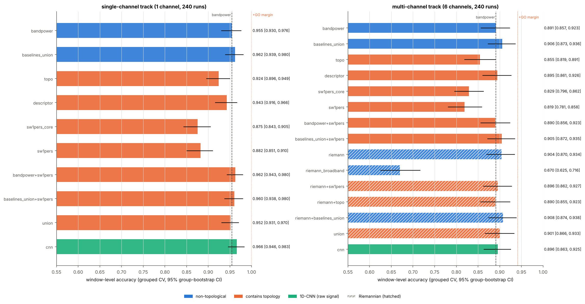
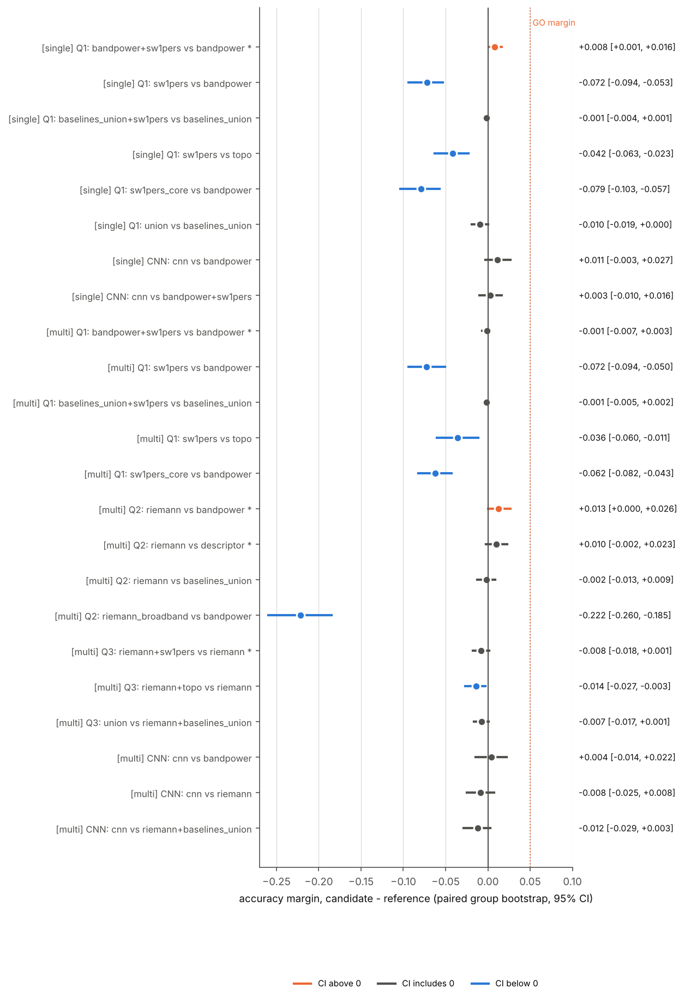
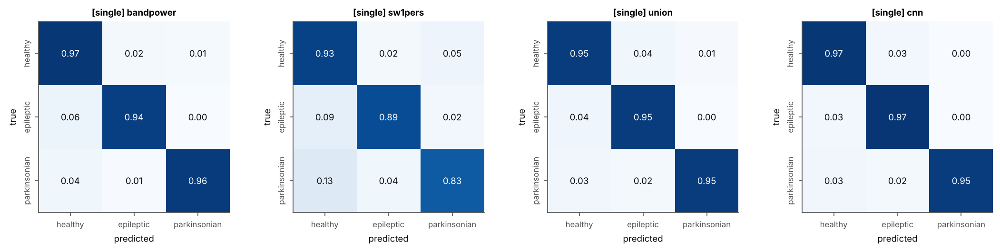
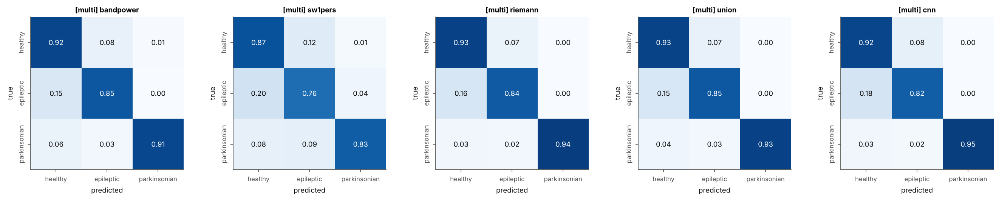
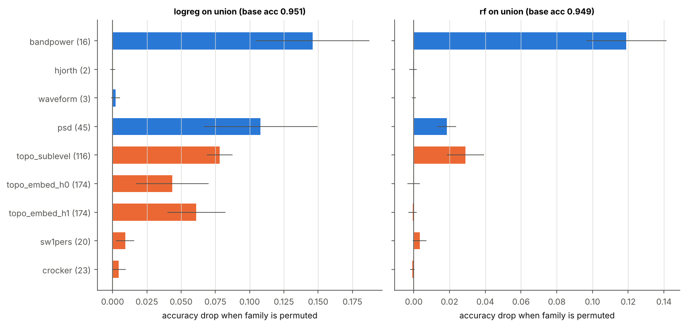
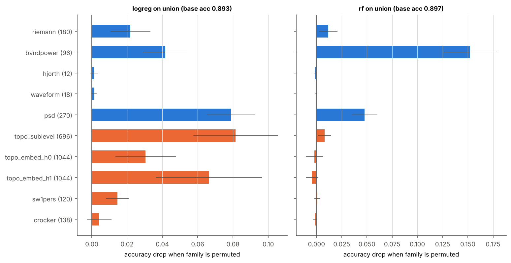
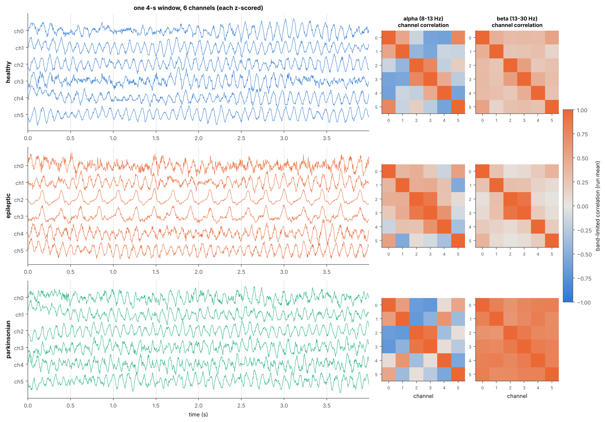
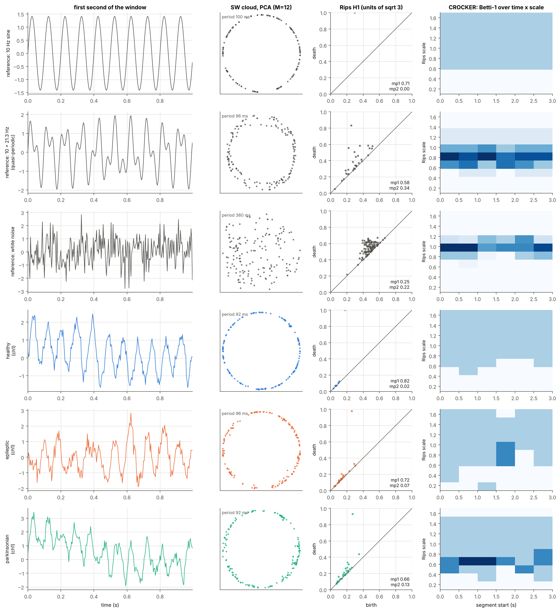

# Results — SW1PerS topology vs a Riemannian baseline (config `sw1pers_full`)

_Generated automatically by `python -m neurorhythms.sw1pers_bench --config ...` on 2026-11-02; runtime 69.5 min. Every number below is read from `results.json`, and the verdicts are produced by fixed rules; do not edit by hand. Interpretation: [`SCIENCE.md`](SCIENCE.md) section 8._

## Answers

Rule (GEM, as in the first benchmark): a comparison is **GO** iff the margin (candidate − reference accuracy) is ≥ +0.05. Each margin has a paired 95 % group-bootstrap CI (resampling simulation runs). Labels: *GO*; *detectable gain below the GO margin* (CI above 0, margin < 0.05); *no detectable difference* (CI includes 0); *worse* (CI below 0). Primary comparisons were fixed before the full run.

### Q1. Does SW1PerS add value over band power? (the fair topology test)

**Answer: NO-GO. [single] bandpower+sw1pers vs bandpower: detectable gain below the GO margin (+0.008 [+0.001, +0.016]); [multi] bandpower+sw1pers vs bandpower: no detectable difference (-0.001 [-0.007, +0.003]).**

| comparison | candidate acc | reference acc | margin [95% CI] | P(margin ≤ 0) | label |
|---|---|---|---|---|---|
| [single] bandpower+sw1pers vs bandpower | 0.962 | 0.955 | +0.008 [+0.001, +0.016] | 0.013 | detectable gain below the GO margin |
| [multi] bandpower+sw1pers vs bandpower | 0.890 | 0.891 | -0.001 [-0.007, +0.003] | 0.654 | no detectable difference |

_Headroom note: `bandpower` scores 0.955, so a +0.05 margin over it is arithmetically impossible._

### Q2. Does Riemannian covariance beat band power and the existing descriptor?

**Answer: NO (not detectably better than both references). [multi] riemann vs bandpower: detectable gain below the GO margin (+0.013 [+0.000, +0.026]); [multi] riemann vs descriptor: no detectable difference (+0.010 [-0.002, +0.023]).**

| comparison | candidate acc | reference acc | margin [95% CI] | P(margin ≤ 0) | label |
|---|---|---|---|---|---|
| [multi] riemann vs bandpower | 0.904 | 0.891 | +0.013 [+0.000, +0.026] | 0.023 | detectable gain below the GO margin |
| [multi] riemann vs descriptor | 0.904 | 0.895 | +0.010 [-0.002, +0.023] | 0.066 | no detectable difference |

### Q3. Does adding topology to the Riemannian features give any incremental value?

**Answer: NO. [multi] riemann+sw1pers vs riemann: no detectable difference (-0.008 [-0.018, +0.001]).**

| comparison | candidate acc | reference acc | margin [95% CI] | P(margin ≤ 0) | label |
|---|---|---|---|---|---|
| [multi] riemann+sw1pers vs riemann | 0.896 | 0.904 | -0.008 [-0.018, +0.001] | 0.955 | no detectable difference |
| [multi] riemann+topo vs riemann | 0.890 | 0.904 | -0.014 [-0.027, -0.003] | 0.994 | worse |
| [multi] union vs riemann+baselines_union | 0.901 | 0.908 | -0.007 [-0.017, +0.001] | 0.956 | no detectable difference |

### Deep model

| track | comparison | candidate acc | reference acc | margin [95% CI] | P(margin ≤ 0) | rule |
|---|---|---|---|---|---|---|
| single | cnn vs bandpower | 0.966 | 0.955 | +0.011 [-0.003, +0.027] | 0.058 | NO-GO |
| single | cnn vs bandpower+sw1pers | 0.966 | 0.962 | +0.003 [-0.010, +0.016] | 0.329 | NO-GO |
| multi | cnn vs bandpower | 0.896 | 0.891 | +0.004 [-0.014, +0.022] | 0.318 | NO-GO |
| multi | cnn vs riemann | 0.896 | 0.904 | -0.008 [-0.025, +0.008] | 0.841 | NO-GO |
| multi | cnn vs riemann+baselines_union | 0.896 | 0.908 | -0.012 [-0.029, +0.003] | 0.933 | NO-GO |

## What was run

- **Single-channel track.** The dataset of the first benchmark: 240 runs (80 per class) of one Jansen-Rit column driven by the STN-GPe loop, 40 s each, 250 Hz, 1/f + white measurement noise, 4 s windows z-scored: 2400 windows.
- **Multi-channel track.** 240 runs of a network of 4 coupled Jansen-Rit columns (ring connectivity, inter-column gain K ~ U(10.0, 30.0), delays U(0.01, 0.025) s) sharing one STN-GPe loop (BG gain to each column x U(0.5, 1.0)), seen by 6 sensors through a Gaussian lead field (width 0.6, per-run jitter U(0.8, 1.2)). Measurement noise as in the single track, with a spatially shared fraction U(0.2, 0.5) of the 1/f background. Epileptic runs have 1 randomly placed focus column(s) in the epileptic regime; parkinsonian runs have a supercritical loop. Every channel of every 4 s window is z-scored: 2400 windows x 6 channels.
- **Protocol.** Repeated StratifiedGroupKFold (4 folds x 5 repeats), group = simulation run, identical folds for every view and the CNN within a track. LogReg (standardised, C = 1) and RandomForest (300 trees), the better of the two per set; 2000 paired group-bootstrap resamples.
- **SW1PerS** (Perea & Harer 2015). Per channel: cubic spline, sliding-window embedding with M = 2N = 12 and window length P·M/(M+1) for target periods P at 4 Hz, 10 Hz, 20 Hz and the window's own dominant period; 160 points; pointwise centring and normalisation; 8-NN mean-shift; Rips H1 over Z_11 (ripser). Features per scale: max persistence mp1 (= 1 − periodicity score), second persistence mp2 (quasi-periodicity), birth of the top class, total persistence, persistent entropy. **CROCKER**: 1 s segments every 0.5 s, Betti-1 on 10 Rips scales in (0.1, 1.7), mean and std over segments, plus mean/std/min of the segment mp1. `sw1pers` = scales + CROCKER; `sw1pers_core` = scales only.
- **Riemannian** (`pyriemann`). Per window, OAS-shrunk covariance of the band-passed channels in the five band-power bands (`riemann`) or of the broadband signal (`riemann_broadband`); tangent space at the Riemannian mean of the training fold (fitted inside every fold). With z-scored channels the diagonal of each band's covariance is the channel's relative band power, so `riemann` contains the relative band powers (and their ratios) and adds cross-channel coupling; it does not contain the finer spectral shape of `bandpower` (peak frequency, spectral edge, entropy).
- **Existing views**: `bandpower` (relative band powers, ratios, SEF, peak frequency, spectral entropy), `baselines_union` (+ Hjorth, skewness/kurtosis/line length, log-PSD), `topo` (sublevel-set + Alpha-complex delay-embedding persistence) and `descriptor` (log-PSD + topo), all per channel and concatenated in the multi track.
- **1D-CNN** on the raw z-scored window (all channels as input channels in the multi track), 25 epochs, AdamW lr 0.001, fixed schedule.

### Do the network classes show their signatures? (noise-free columns, no classifier)

| class | runs | median column beta fraction | runs with a column beta ≥ 0.10 | runs with a spiking column | focus columns spiking |
|---|---|---|---|---|---|
| healthy | 80 | 0.021 | 2 % | 2 % |  |
| epileptic | 80 | 0.027 | 12 % | 75 % | 75 % |
| parkinsonian | 80 | 0.171 | 90 % | 1 % |  |

A column is *spiking* if its slow (1-7.5 Hz) power fraction exceeds 0.5 and its skewness exceeds 0.5.

## Accuracy of every view

### single-channel track

| group | feature set | # features | LogReg | RF | best [95% CI] | macro-F1 | run-level acc |
|---|---|---|---|---|---|---|---|
| baseline | **bandpower** | 16 | 0.955 | 0.947 | 0.955 [0.930, 0.976] (logreg) | 0.955 | 0.963 |
| baseline | **baselines_union** | 66 | 0.955 | 0.962 | 0.962 [0.939, 0.980] (rf) | 0.962 | 0.962 |
| existing topology | **topo** | 464 | 0.908 | 0.924 | 0.924 [0.896, 0.949] (rf) | 0.925 | 0.938 |
| existing topology | **descriptor** | 509 | 0.939 | 0.943 | 0.943 [0.916, 0.966] (rf) | 0.943 | 0.951 |
| SW1PerS | **sw1pers_core** | 20 | 0.874 | 0.875 | 0.875 [0.843, 0.905] (rf) | 0.877 | 0.915 |
| SW1PerS | **sw1pers** | 43 | 0.882 | 0.879 | 0.882 [0.851, 0.910] (logreg) | 0.883 | 0.932 |
| SW1PerS | **bandpower+sw1pers** | 59 | 0.962 | 0.947 | 0.962 [0.943, 0.980] (logreg) | 0.963 | 0.973 |
| SW1PerS | **baselines_union+sw1pers** | 109 | 0.957 | 0.960 | 0.960 [0.938, 0.980] (rf) | 0.960 | 0.960 |
| everything | **union** | 573 | 0.952 | 0.952 | 0.952 [0.931, 0.970] (logreg) | 0.952 | 0.967 |
| deep model | **cnn** | raw signal (47,427 params) | – | – | 0.966 [0.946, 0.983] | 0.966 | 0.968 |

### multi-channel track

| group | feature set | # features | LogReg | RF | best [95% CI] | macro-F1 | run-level acc |
|---|---|---|---|---|---|---|---|
| baseline | **bandpower** | 96 | 0.870 | 0.891 | 0.891 [0.857, 0.923] (rf) | 0.893 | 0.897 |
| baseline | **baselines_union** | 396 | 0.890 | 0.906 | 0.906 [0.873, 0.936] (rf) | 0.907 | 0.912 |
| existing topology | **topo** | 2784 | 0.850 | 0.855 | 0.855 [0.819, 0.891] (rf) | 0.857 | 0.877 |
| existing topology | **descriptor** | 3054 | 0.885 | 0.895 | 0.895 [0.861, 0.926] (rf) | 0.895 | 0.903 |
| SW1PerS | **sw1pers_core** | 120 | 0.829 | 0.819 | 0.829 [0.796, 0.862] (logreg) | 0.830 | 0.886 |
| SW1PerS | **sw1pers** | 258 | 0.813 | 0.819 | 0.819 [0.781, 0.858] (rf) | 0.820 | 0.858 |
| SW1PerS | **bandpower+sw1pers** | 354 | 0.856 | 0.890 | 0.890 [0.856, 0.923] (rf) | 0.891 | 0.893 |
| SW1PerS | **baselines_union+sw1pers** | 654 | 0.886 | 0.905 | 0.905 [0.872, 0.935] (rf) | 0.906 | 0.907 |
| Riemannian | **riemann** | 105 | 0.880 | 0.904 | 0.904 [0.870, 0.934] (rf) | 0.905 | 0.912 |
| Riemannian | **riemann_broadband** | 21 | 0.552 | 0.670 | 0.670 [0.625, 0.716] (rf) | 0.671 | 0.703 |
| Riemannian | **riemann+baselines_union** | 501 | 0.892 | 0.908 | 0.908 [0.874, 0.938] (rf) | 0.909 | 0.912 |
| Riemannian + topology | **riemann+sw1pers** | 363 | 0.865 | 0.896 | 0.896 [0.862, 0.927] (rf) | 0.897 | 0.906 |
| Riemannian + topology | **riemann+topo** | 2889 | 0.876 | 0.890 | 0.890 [0.855, 0.923] (rf) | 0.891 | 0.898 |
| everything | **union** | 3543 | 0.896 | 0.901 | 0.901 [0.866, 0.933] (rf) | 0.902 | 0.903 |
| deep model | **cnn** | raw signal (47,987 params) | – | – | 0.896 [0.863, 0.925] | 0.897 | 0.903 |

## Every pre-specified comparison

`*` = primary comparison of its question.

| track | question | candidate | reference | candidate acc | reference acc | margin [95% CI] | P(margin ≤ 0) | rule |
|---|---|---|---|---|---|---|---|---|
| single | Q1 * | bandpower+sw1pers | bandpower | 0.962 | 0.955 | +0.008 [+0.001, +0.016] | 0.013 | NO-GO |
| single | Q1 | sw1pers | bandpower | 0.882 | 0.955 | -0.072 [-0.094, -0.053] | 1.000 | NO-GO |
| single | Q1 | baselines_union+sw1pers | baselines_union | 0.960 | 0.962 | -0.001 [-0.004, +0.001] | 0.834 | NO-GO |
| single | Q1 | sw1pers | topo | 0.882 | 0.924 | -0.042 [-0.063, -0.023] | 1.000 | NO-GO |
| single | Q1 | sw1pers_core | bandpower | 0.875 | 0.955 | -0.079 [-0.103, -0.057] | 1.000 | NO-GO |
| single | Q1 | union | baselines_union | 0.952 | 0.962 | -0.010 [-0.019, +0.000] | 0.968 | NO-GO |
| single | CNN | cnn | bandpower | 0.966 | 0.955 | +0.011 [-0.003, +0.027] | 0.058 | NO-GO |
| single | CNN | cnn | bandpower+sw1pers | 0.966 | 0.962 | +0.003 [-0.010, +0.016] | 0.329 | NO-GO |
| multi | Q1 * | bandpower+sw1pers | bandpower | 0.890 | 0.891 | -0.001 [-0.007, +0.003] | 0.654 | NO-GO |
| multi | Q1 | sw1pers | bandpower | 0.819 | 0.891 | -0.072 [-0.094, -0.050] | 1.000 | NO-GO |
| multi | Q1 | baselines_union+sw1pers | baselines_union | 0.905 | 0.906 | -0.001 [-0.005, +0.002] | 0.757 | NO-GO |
| multi | Q1 | sw1pers | topo | 0.819 | 0.855 | -0.036 [-0.060, -0.011] | 0.999 | NO-GO |
| multi | Q1 | sw1pers_core | bandpower | 0.829 | 0.891 | -0.062 [-0.082, -0.043] | 1.000 | NO-GO |
| multi | Q2 * | riemann | bandpower | 0.904 | 0.891 | +0.013 [+0.000, +0.026] | 0.023 | NO-GO |
| multi | Q2 * | riemann | descriptor | 0.904 | 0.895 | +0.010 [-0.002, +0.023] | 0.066 | NO-GO |
| multi | Q2 | riemann | baselines_union | 0.904 | 0.906 | -0.002 [-0.013, +0.009] | 0.628 | NO-GO |
| multi | Q2 | riemann_broadband | bandpower | 0.670 | 0.891 | -0.222 [-0.260, -0.185] | 1.000 | NO-GO |
| multi | Q3 * | riemann+sw1pers | riemann | 0.896 | 0.904 | -0.008 [-0.018, +0.001] | 0.955 | NO-GO |
| multi | Q3 | riemann+topo | riemann | 0.890 | 0.904 | -0.014 [-0.027, -0.003] | 0.994 | NO-GO |
| multi | Q3 | union | riemann+baselines_union | 0.901 | 0.908 | -0.007 [-0.017, +0.001] | 0.956 | NO-GO |
| multi | CNN | cnn | bandpower | 0.896 | 0.891 | +0.004 [-0.014, +0.022] | 0.318 | NO-GO |
| multi | CNN | cnn | riemann | 0.896 | 0.904 | -0.008 [-0.025, +0.008] | 0.841 | NO-GO |
| multi | CNN | cnn | riemann+baselines_union | 0.896 | 0.908 | -0.012 [-0.029, +0.003] | 0.933 | NO-GO |

## Confusion matrices (row-normalised, pooled over repeats)

single: bandpower

| true \ predicted | healthy | epileptic | parkinsonian |
|---|---|---|---|
| healthy | 0.970 | 0.018 | 0.012 |
| epileptic | 0.062 | 0.938 | 0.000 |
| parkinsonian | 0.037 | 0.008 | 0.955 |

single: sw1pers

| true \ predicted | healthy | epileptic | parkinsonian |
|---|---|---|---|
| healthy | 0.928 | 0.023 | 0.049 |
| epileptic | 0.090 | 0.887 | 0.024 |
| parkinsonian | 0.131 | 0.037 | 0.832 |

single: union

| true \ predicted | healthy | epileptic | parkinsonian |
|---|---|---|---|
| healthy | 0.952 | 0.038 | 0.009 |
| epileptic | 0.044 | 0.953 | 0.003 |
| parkinsonian | 0.032 | 0.017 | 0.951 |

single: cnn

| true \ predicted | healthy | epileptic | parkinsonian |
|---|---|---|---|
| healthy | 0.971 | 0.028 | 0.002 |
| epileptic | 0.026 | 0.973 | 0.001 |
| parkinsonian | 0.032 | 0.016 | 0.953 |

multi: bandpower

| true \ predicted | healthy | epileptic | parkinsonian |
|---|---|---|---|
| healthy | 0.916 | 0.076 | 0.008 |
| epileptic | 0.151 | 0.848 | 0.001 |
| parkinsonian | 0.065 | 0.026 | 0.909 |

multi: sw1pers

| true \ predicted | healthy | epileptic | parkinsonian |
|---|---|---|---|
| healthy | 0.868 | 0.120 | 0.013 |
| epileptic | 0.195 | 0.762 | 0.043 |
| parkinsonian | 0.082 | 0.091 | 0.827 |

multi: riemann

| true \ predicted | healthy | epileptic | parkinsonian |
|---|---|---|---|
| healthy | 0.932 | 0.066 | 0.002 |
| epileptic | 0.161 | 0.839 | 0.001 |
| parkinsonian | 0.035 | 0.024 | 0.942 |

multi: union

| true \ predicted | healthy | epileptic | parkinsonian |
|---|---|---|---|
| healthy | 0.925 | 0.074 | 0.000 |
| epileptic | 0.153 | 0.846 | 0.001 |
| parkinsonian | 0.044 | 0.025 | 0.931 |

multi: cnn

| true \ predicted | healthy | epileptic | parkinsonian |
|---|---|---|---|
| healthy | 0.917 | 0.083 | 0.000 |
| epileptic | 0.176 | 0.823 | 0.001 |
| parkinsonian | 0.034 | 0.019 | 0.947 |

## Post hoc: where are the errors? (exploratory, not part of the verdicts)

Each run is classified, from its *noise-free* model output and without any classifier, as showing its class signature or as *borderline*. Single track: the criteria of the first benchmark (alpha-dominant / slow + skewed / beta ≥ 0.10). Multi track: epileptic = some column spikes (slow fraction > 0.5 and skewness > 0.5), parkinsonian = some column has beta fraction ≥ 0.10, healthy = neither. Window accuracy is then split by run type, using the out-of-fold predictions of the main run (no re-training).

**single-channel track**: borderline runs per class healthy 1 of 80, epileptic 8 of 80, parkinsonian 11 of 80.

| feature set | acc, runs with signature | acc, borderline runs | borderline healthy recall | borderline epileptic recall | borderline parkinsonian recall |
|---|---|---|---|---|---|
| bandpower | 0.991 | 0.555 | 0.000 | 0.380 | 0.733 |
| baselines_union | 0.995 | 0.595 | 0.000 | 0.383 | 0.804 |
| descriptor | 0.988 | 0.438 | 0.000 | 0.310 | 0.571 |
| sw1pers | 0.936 | 0.293 | 0.000 | 0.110 | 0.453 |
| bandpower+sw1pers | 0.991 | 0.646 | 0.000 | 0.463 | 0.838 |
| union | 0.983 | 0.610 | 0.000 | 0.565 | 0.698 |
| cnn | 0.991 | 0.691 | 0.000 | 0.738 | 0.720 |

**multi-channel track**: borderline runs per class healthy 4 of 80, epileptic 20 of 80, parkinsonian 8 of 80.

| feature set | acc, runs with signature | acc, borderline runs | borderline healthy recall | borderline epileptic recall | borderline parkinsonian recall |
|---|---|---|---|---|---|
| bandpower | 0.960 | 0.444 | 0.455 | 0.397 | 0.557 |
| baselines_union | 0.968 | 0.501 | 0.495 | 0.434 | 0.672 |
| descriptor | 0.960 | 0.471 | 0.500 | 0.391 | 0.655 |
| sw1pers | 0.902 | 0.281 | 0.370 | 0.242 | 0.335 |
| bandpower+sw1pers | 0.962 | 0.423 | 0.460 | 0.388 | 0.492 |
| riemann | 0.970 | 0.479 | 0.500 | 0.407 | 0.650 |
| riemann+sw1pers | 0.967 | 0.436 | 0.480 | 0.366 | 0.590 |
| union | 0.967 | 0.467 | 0.500 | 0.396 | 0.627 |
| cnn | 0.956 | 0.506 | 0.500 | 0.443 | 0.667 |

## Which feature families does the `union` model rely on?

Grouped permutation importance on held-out folds of repeat 1 (all columns of a family permuted together; mean accuracy drop). It measures reliance of a fitted model, not unique information: redundant families can each look unimportant to a random forest.

**single-channel track**

| family | # columns | logreg drop | rf drop |
|---|---|---|---|
| bandpower | 16 | +0.146 | +0.119 |
| hjorth | 2 | +0.000 | -0.000 |
| waveform | 3 | +0.002 | -0.000 |
| psd | 45 | +0.108 | +0.018 |
| topo_sublevel | 116 | +0.078 | +0.029 |
| topo_embed_h0 | 174 | +0.044 | -0.000 |
| topo_embed_h1 | 174 | +0.061 | -0.001 |
| sw1pers | 20 | +0.009 | +0.003 |
| crocker | 23 | +0.004 | -0.001 |

**multi-channel track**

| family | # columns | logreg drop | rf drop |
|---|---|---|---|
| riemann | 180 | +0.022 | +0.012 |
| bandpower | 96 | +0.042 | +0.152 |
| hjorth | 12 | +0.001 | -0.001 |
| waveform | 18 | +0.002 | -0.000 |
| psd | 270 | +0.079 | +0.048 |
| topo_sublevel | 696 | +0.081 | +0.008 |
| topo_embed_h0 | 1044 | +0.031 | -0.002 |
| topo_embed_h1 | 1044 | +0.066 | -0.005 |
| sw1pers | 120 | +0.015 | +0.001 |
| crocker | 138 | +0.004 | -0.001 |

(`riemann` columns are the raw covariance entries; the tangent-space projection is refitted inside the fold pipeline, so permuting them swaps whole matrices between windows.)

## Sanity checks (leak detectors)

| track | check | value | expectation |
|---|---|---|---|
| single | union / LogReg with run labels permuted | 0.332 | chance (0.333) |
| single | bandpower / RF, grouped (repeat 1) vs ungrouped CV | 0.943 vs 0.967 | ungrouped ≥ grouped |
| single | sw1pers / RF, grouped (repeat 1) vs ungrouped CV | 0.877 vs 0.887 | ungrouped ≥ grouped |
| multi | union / LogReg with run labels permuted | 0.321 | chance (0.333) |
| multi | riemann / LogReg with run labels permuted | 0.320 | chance (0.333) |
| multi | bandpower / RF, grouped (repeat 1) vs ungrouped CV | 0.885 vs 0.946 | ungrouped ≥ grouped |
| multi | sw1pers / RF, grouped (repeat 1) vs ungrouped CV | 0.817 vs 0.879 | ungrouped ≥ grouped |
| multi | riemann / RF, grouped (repeat 1) vs ungrouped CV | 0.901 vs 0.943 | ungrouped ≥ grouped |

## Figures

## Caveats

- Synthetic data: classes are parameter regimes of neural-mass models; this measures which representation recovers the regime, not clinical diagnostic accuracy.
- Best-of-two classifiers per set is mildly optimistic, applied identically to every set.
- The multi-channel montage is a minimal network (4 columns, 6 sensors, Gaussian lead field), not a head model. Its network ranges were set from physiology and a pilot (seed 999) that ran only the band-power reference, to confirm there was headroom above it; no candidate view was run on the pilot to choose data or hyperparameters.
- Windows are the classification unit; runs are the resampling unit of every CI.
